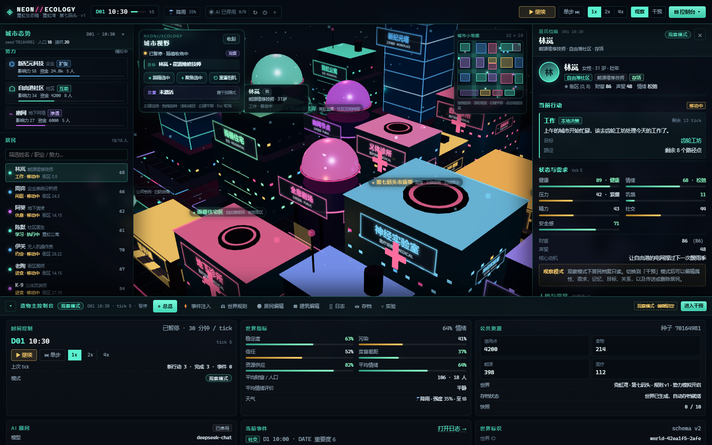

# NEON//ECOLOGY｜霓虹生态箱

> 一座会自己活下去的 3D 赛博朋克城市。你是造物主，不是编剧。
>
> 观察 18 名居民工作、吃饭、恋爱、争吵、合作、隐瞒与背叛；暂停时间，改写规则，注入灾难，保存世界，或者把一个世界复制成两个，看它们各自走向哪里。



*真实浏览器截图（1600×1000）：3D 街区、居民档案、城市态势与可折叠的造物主控制台。*

## 1. 快速开始

环境要求：Node.js **20+**（本项目在 Node 24.22 / npm 11.19 上验证），Windows / macOS / Linux 均可。

```bash
npm install
npm run dev
```

打开 **http://localhost:5173**。

开发模式会同时启动：

- Vite 前端：`http://localhost:5173`
- Express 服务端：`http://localhost:3000`（Vite 将 `/api` 代理到它）

生产模式：

```bash
npm start
```

它会先构建前端（`dist/`），然后由 Express 在 **http://localhost:3000** 同时提供界面和 API。

> 旧版原型（原生 JS + CSS 地图）已完整保留在 `archive/v0-prototype/`，未删除。当前版本在其愿景基础上重写为可交互 3D 模拟沙盒。

## 2. 离线运行与 DeepSeek

没有 API Key 时也能完整运行：居民决策、移动、社交、经济、势力、事件、存档、快照、分支实验全部不依赖 AI。

配置 AI 顾问（可选）：

1. 复制 `.env.example` 为 `.env`（当前工作区已有 `.env`，请勿提交）。
2. 在 `.env` 填入：

```dotenv
DEEPSEEK_API_KEY=你的密钥
DEEPSEEK_BASE_URL=https://api.deepseek.com
DEEPSEEK_MODEL=deepseek-chat
```

3. 重启服务。顶部 AI 状态徽标会显示在线/离线；控制台「总览」显示调用次数、失败次数、拒绝次数、延迟与最近消息。

AI 的职责边界：

- AI 只返回通过 schema 校验的 **行动提案**：`{ action, targetId?, reason }`。
- 服务端校验 JSON、行动白名单、目标白名单、理由长度与请求限流。
- 客户端模拟引擎再次校验行动前置条件；提案先进入居民的 `aiHint`，在下一次自主决策时由引擎按正常规则处理。
- AI **不能**直接增加资源、修改关系、推进时间或改写存档。所有可见世界变化都来自 `src/sim/engine.ts` / `src/sim/commands.ts`。
- 超时、非法 JSON、未知行动、未知目标、资源不足、API 故障都会安全回退；模拟不会停止，存档不会损坏。

服务端环境变量（完整见 `.env.example`）：

| 变量 | 默认 | 说明 |
| --- | --- | --- |
| `DEEPSEEK_API_KEY` | 空 | 仅服务端读取，空 = 离线 |
| `DEEPSEEK_BASE_URL` | `https://api.deepseek.com` | 兼容 DeepSeek 接口的地址 |
| `DEEPSEEK_MODEL` | `deepseek-chat` | 模型名 |
| `AI_ENABLED` | `true` | 服务端 AI 总开关 |
| `AI_TIMEOUT_MS` | `15000` | 单次上游请求超时 |
| `AI_MAX_REQUESTS_PER_HOUR` | `48` | 服务端硬限流 |
| `AI_MIN_INTERVAL_MS` | `1800` | 两次请求最小间隔 |
| `AI_MAX_TOKENS` | `700` | 模型最大输出 token |

## 3. 操作方式

- **鼠标左键**：选择居民或建筑；点击地面取消选择。
- **拖动 / 滚轮 / 右键拖动**：旋转 / 缩放 / 平移城市（左上控件可跟随选中居民、聚焦、重置相机）。
- **Space**：暂停/继续（输入框聚焦时不会触发）。
- **顶部时间条**：暂停、单步推进、1×/2×/4× 倍速。
- **观察模式**：只查看城市和居民。
- **干预模式**：解锁人物、建筑、规则、事件与实验编辑。
- **底部控制台**：总览、事件注入、世界规则、居民编辑、建筑编辑、事件日志、存档、平行世界。可折叠，不会永久遮住城市。
- 右侧详情面板：点击居民或建筑后出现；可关闭；关系条目可点击切换人物。

## 4. 当前世界

- 32×28 瓦片街区，20 座建筑：5 座住宅、商店、工作场所、公共空间（含开放的霓虹公园）、医疗设施与能源基础设施。
- 18 名居民，每人拥有：
  - 身份、年龄、职业、势力、性格五维、价值观、技能、财富、健康、情绪、压力；
  - 饥饿/精力/社交/安全感需求与个人日程；
  - 长期目标、短期目标、当前计划、行动历史与决策理由；
  - 对每名熟人的独立关系认知（好感、信任、亲密、吸引、敌意、关系类型、互动历史）；
  - 近期记忆、重要记忆、长期摘要、人物印象、秘密与承诺；
  - 移动路径、建筑内状态、真实行动结果。
- 3 个势力：新纪元科技（企业）、自由港社区（自治）、幽网（地下网络）。它们有资金、资源、影响力、目标、成员、领导者和对外关系，并由规则驱动招募、投资、配给、竞争与信息操作。
- 城市社会指标：稳定度、污染、公众信任、贫富差距、资源供应、平均情绪与财富。指标来自真实状态与事件，而非模型文案。
- 10 种造物主事件注入：停电、污染泄漏、裁员、粮食短缺、疾病、政策改革、事故、庆典、谣言风暴、外部援助。每种都会实际修改资源、健康、关系、建筑或规则。
- 昼夜、天气、酸雨、雾霾、热浪、电磁风暴、年龄增长、疾病、衰老与死亡均会持续演化。死亡会真实影响伴侣/朋友的情绪、记忆、财富与势力。

关系不是一次性随机判定：恋爱需要双方长期积累的吸引、信任、亲密与互动；争执与和解会改变双方不同方向的认知；背叛会转移财富、破坏信任并留下长期创伤记忆。

## 5. 目录结构

```text
neon-ecology/
├── index.html                 # Vite HTML 入口
├── package.json
├── vite.config.ts             # Vite + React + /api 代理
├── tsconfig.json              # 前端/共享类型检查
├── tsconfig.server.json       # 服务端/测试类型检查
├── .env.example               # 环境变量模板（无真实 Key）
├── docs/
│   ├── ARCHITECTURE.md        # 数据流、更新顺序、边界与 AI 安全设计
│   └── CONTRACTS.md           # 并行开发模块契约
├── src/
│   ├── shared/
│   │   ├── types.ts           # 领域模型（唯一权威类型）
│   │   ├── constants.ts       # tick、地图、规则、事件、动作与 UI 元数据
│   │   ├── ai.ts              # AI 请求/提案 Zod schema 与类型
│   │   └── format.ts          # 中文显示格式化
│   ├── sim/
│   │   ├── data.ts            # 初始世界：建筑、居民、势力、关系、记忆
│   │   ├── rng.ts             # 可存档的确定性 PRNG
│   │   ├── city.ts            # 网格、建筑占地、门、A* 寻路、坐标转换
│   │   ├── engine.ts          # 固定步长模拟、决策、行动、关系、势力、生命周期
│   │   ├── metrics.ts         # 指标推导
│   │   ├── social.ts          # 双向关系、印象、传闻记忆
│   │   ├── events.ts          # 事件日志、结构化记忆、人生事件
│   │   ├── commands.ts        # 造物主编辑/事件/规则/建造/拆除命令
│   │   ├── aiContext.ts       # AI 上下文构建、提案落地为居民建议
│   │   └── save.ts            # Zod 存档校验、快照、分支比较
│   ├── store/
│   │   ├── simulationStore.ts # React 外部的单一状态源、时钟、AI 调度、存档
│   │   └── useSimulation.ts   # useSyncExternalStore hook
│   ├── components/
│   │   ├── CityScene.tsx      # Three.js Canvas 入口
│   │   ├── scene/             # 地面/道路/建筑/居民/相机/交互
│   │   ├── TopBar.tsx
│   │   ├── WorldSidebar.tsx
│   │   ├── Inspector.tsx
│   │   ├── CreatorConsole.tsx # 8 个造物主 tab
│   │   └── ...
│   └── styles/
│       ├── base.css
│       ├── ui.css
│       └── scene.css
├── server/
│   ├── app.ts                 # Express app 工厂（可测试）
│   ├── index.ts               # 生产入口
│   ├── config.ts              # 服务端配置
│   └── aiService.ts           # DeepSeek 调用、限流、安全校验
├── tests/                     # Vitest：引擎/导航/存档/服务端
├── scripts/
│   └── browser-smoke.ts       # Playwright + 本机 Chrome 真实浏览器验收
└── archive/v0-prototype/      # 旧原生原型完整备份
```

## 6. 架构与规则边界

- **模拟引擎**是唯一的规则权威，固定步长：一个 tick = 30 模拟分钟，48 tick = 1 天。渲染帧率与模拟时钟完全独立。
- 每个 tick 的更新顺序固定为：推进时钟 → 跨日结算（生产/消耗/税/福利/维护/衰老）→ 天气与环境 → 居民（按数组稳定顺序）更新需求/行动/决策 → 社交与目标 → 派生指标 → 势力行动 → 历史采样。
- 随机数状态保存在 `WorldState.rngState`，存档、快照和分支都会带上它；同一世界在同一状态下推进结果可复现。
- 3D 层只读取 `SimulationUiState`，只调用 store 的公开动作；不会直接修改世界规则或居民数据。
- AI 调用不在渲染循环、也不在引擎内部。store 在每 `aiAdvisorFrequencyTicks` 个 tick 后（或玩家手动请求）发起一次，过程中居民继续用本地规则生活。
- 高开销编辑操作（拆除、删除、重置、恢复快照）必须二次确认；所有输入在进入引擎前校验，非法值被拒绝并展示中文错误。

更详细的数据流与安全设计见 [docs/ARCHITECTURE.md](docs/ARCHITECTURE.md)。

## 7. 测试与验收

```bash
npm run typecheck          # 前端 + 服务端 TypeScript
npm test                   # 全部 Vitest 测试（98 个）
npm run test:engine        # 只跑引擎测试
npm run build              # Vite 生产构建
npm start                  # 构建 + 启动生产服务（http://localhost:3000）

# 可选：真实浏览器交互验收（需本机 Chrome，且服务已在 :3000 启动）
npm run test:browser       # Playwright-core，使用本机 Chrome，不下载浏览器
# 如 Chrome 不在默认路径：
# $env:CHROME_PATH="C:\path\to\chrome.exe"; npm run test:browser
```

浏览器验收会实际加载页面、确认 WebGL Canvas、点击侧栏居民、点击 3D 居民与建筑、暂停/单步、切换干预、注入事件、写入 localStorage 存档、捕获并比较快照，并检查 `pageerror` / `console error`。测试在启动时临时关闭自动 AI，避免消耗真实 DeepSeek 额度；如需手动验证 AI，可在页面里点选居民后点击顶部 `✦`。默认只对 Windows 的 Chrome 路径做了测试，其他平台用 `CHROME_PATH` 指向本机 Chrome/Chromium。

测试覆盖：

- 初始世界规模、确定性（相同种子同结果、不同种子不同）；200/500 tick 的位置与进出建筑不变量；
- 每次 tick 恰好推进 30 分钟；跨日；暂停/单步/计时器边界；
- A* 190 对建筑门路径不穿墙、居民进入/离开建筑；
- 关系双向差异、记忆保留规则、目标推进与受阻；重要记忆不被普通记忆挤出；
- 规则修改、事件注入、人物/建筑编辑、原子失败、放置冲突检查、拆除后的引用修复；
- 存档 roundtrip、损坏/越界/版本不匹配存档拒绝、快照比较；导入不修改原文件；
- AI 上下文 schema、非法目标/越权行动/类型不匹配拒绝、合法建议进入引擎队列、离线回退；
- 服务端无 Key、非法请求、非法 JSON、未知行动/目标、限流、上游错误的 39 个测试。

**本次验收记录（2026-10-20）**

| 命令/检查 | 结果 |
| --- | --- |
| `npm run typecheck` | 前端与服务端均 0 错误 |
| `npm test` | 4 个测试文件，98/98 通过 |
| `npm run build` | 成功（680 modules；three chunk 981.14 kB / gzip 271.70 kB） |
| `npm run test:browser` | PASS：WebGL、18 名居民、3D 点选聚焦后的居民“唐糖”、3D 建筑点选、暂停/单步、事件注入、存档、快照比较；0 pageerror / 0 console error |
| 无 Key 离线浏览器验收 | 独立离线服务（`DEEPSEEK_API_KEY` 为空）下同一套 E2E PASS；AI 徽标显示离线，世界照常运行 |
| 真实 DeepSeek 手动冒烟 | `/api/ai/decision` 返回结构化提案，约 0.7–3 秒；`/api/status` 在线，响应与日志不含 Key |

没有 API Key 也能运行完整单元测试；服务端测试使用 mock 上游，不会消耗真实调用。

## 8. 已知限制与后续建议

**已实现并验证的核心范围**

- 可交互 3D 街区、建筑与居民的点击/悬停/选中/相机控制；
- 18 名居民的需求、日程、目标、关系、记忆、社交、移动和建筑进出；
- 招聘/互助/情报等规则驱动势力行为；
- 时间控制、事件注入、规则编辑、人物/建筑编辑、日志、存档与导入导出；
- 10 个本地快照、恢复、分支世界与快照对比；
- DeepSeek 结构化行动提案、服务端双重校验、超时/重试/限流/离线回退。

**有意留到后续版本**

- 出生与代际繁衍：当前有衰老、疾病和死亡；新居民可通过造物主创建，但自然生育/成长尚未实现。
- 势力分裂与正式外交协议：已有竞争、合作、信息操作、招募与衰退表现，复杂组织政治仍是规则驱动占位。
- 更大地图/多街区、GPU InstancedMesh 大规模人群、Web Worker 常驻引擎：当前单街区 18 人在桌面浏览器可流畅运行，先保证可读性与正确性。
- AI 组织领导者：当前只有居民个人 AI 顾问，势力仍由确定性规则驱动。
- 更丰富的自动长期摘要：当前用结构化重要记忆与简短长期摘要，尚未接入定期摘要模型（避免额外费用与不可控文本）。
- 社交关系网络可视化：详情面板提供可点击关系列表；力导向图可作为下一版增强。

**已知行为 / 场景限制**

- 没有 API Key 时，顶部 AI 徽标显示离线，控制台不会产生 AI 调用；居民仍按本地规则生活。
- 浏览器 `localStorage` 存档只存在本机；重要进度请用「存档 → 导出 JSON」备份。
- 快照最多 10 个，事件日志最多保留最近 260 条，重要记忆有独立容量，不会因普通记忆清理而丢失。
- 如果长期无人干预且资源枯竭，城市可能进入饥荒/高压力状态，这是模拟结果，不是 bug。
- 居民在建筑内时以 30% 半透明“室内状态”留在门口以便选中；镜头聚焦居民时如果中间隔着高楼，视线可能被建筑遮挡，玩家可旋转/缩放镜头后点击。天空点击不会清空选择（防止拖动旋转时误取消）；清空请点击地面或按 Esc。
- 建筑外观在运行中不随 condition/open 状态改变，状态通过霓虹标签、面板与交互体现（性能取可持续的静态体块）。
- 场景是单街区、无骨骼动画；低端集成显卡上可关闭其他 WebGL 页面，后续可增加质量档位或 InstancedMesh。

## 9. 常见故障排查

| 现象 | 处理 |
| --- | --- |
| `http://localhost:5173` 打不开 | 先确认 `npm run dev` 的 SERVER 和 WEB 两个进程都没退出；检查端口 3000/5173 是否被占用 |
| 页面加载但 AI 显示离线 | `.env` 无 Key 或服务端未重启；离线是设计行为，不影响模拟 |
| AI 请求持续失败 | 控制台会显示错误；检查 `DEEPSEEK_API_KEY`、网络、`DEEPSEEK_BASE_URL`、额度与限流；居民会自动回退本地决策 |
| 修改数值没反应 | 确认已切到「干预模式」；观察模式禁止编辑 |
| 导入存档失败 | 只接受本版本导出的 JSON；控制台会显示具体校验错误；不要导入损坏文件 |
| 保存/读取异常 | 清理浏览器存储可能丢档；请优先导出 JSON。快照与自动存档使用独立 key |
| 端口冲突 | 在 `.env` 改 `PORT`；同时修改 `vite.config.ts` 中代理目标或在 dev 脚本中统一端口 |
| 3D 卡顿 | 降低浏览器缩放/关闭其他 WebGL 页面；当前没有自动降级，后续可加质量档位 |
| 测试失败 | 先运行 `npm run typecheck` 找类型问题；测试日志会指出失败引擎/存档/服务端行为 |

## 10. 安全

- API Key 只在服务端 `process.env` 中读取；前端源码、构建产物、状态 API 与日志均不包含密钥。
- 服务端拒绝超过限制的请求体、未知字段和非法 schema；模型输出不执行代码、不插入 HTML。
- 前端所有模型文本通过 React 渲染转义，没有 `dangerouslySetInnerHTML`、`eval` 或动态脚本执行。
- `.env` 已在 `.gitignore` 中；不要提交真实密钥。
